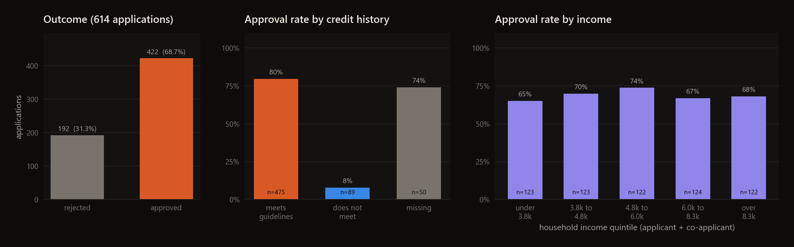
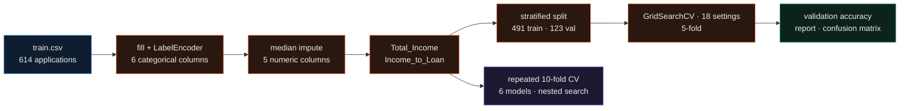
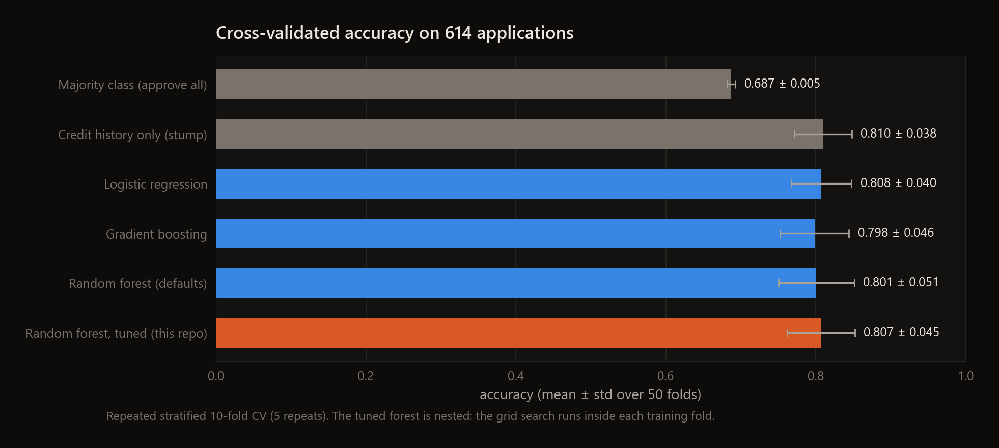
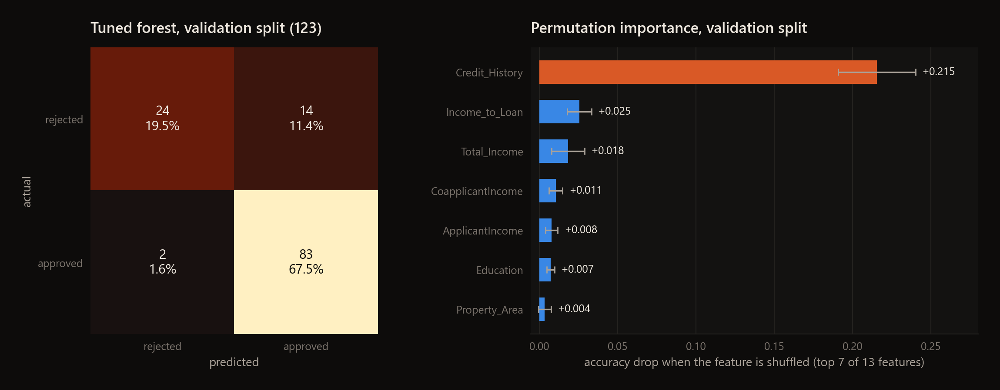

<div align="center">

# Loan Prediction

**A tuned random forest that predicts home-loan approval from 11 application fields, measured against a one-column credit-history baseline.**




</div>

The data is the loan-approval set from Analytics Vidhya's Loan Prediction practice problem: 614 labelled
applications with income, loan amount and term, credit history, and household details (`data/train.csv`), plus
367 unlabelled ones (`data/test.csv`). `loan_prediction.py` cleans it, adds two income features, tunes a random
forest with a grid search and scores it on a 20% validation split. I then cross-validated the whole procedure
against simpler models to see how much the forest adds.

## Highlights

- On the script's own split the tuned forest gets 0.870 accuracy (107 of 123 applications).
- Nested 10-fold cross-validation puts the same procedure at 0.807 ± 0.045, so that split was a favourable draw.
- Credit history decides most cases: 80% of applicants who meet the guidelines are approved, against 8% of those who don't. A one-split stump on that column scores 0.810 in the same CV.
- On the validation split the forest's predictions match "approve if credit history is good" for 96.7% of applications. Shuffling `Credit_History` costs it 0.215 accuracy; no other feature is worth more than 0.03.
- Income barely moves the outcome. Approval stays between 65% and 74% across household-income quintiles.

---

## How it works



The grid covers `n_estimators` (50, 100), `max_depth` (5, 10, None) and `min_samples_split` (2, 5, 10). The winner is
50 trees, depth 5 and a minimum split of 10, at 0.798 inner-CV accuracy on the training part.

## Results

Validation numbers use the script's stratified 80/20 split (`random_state=42`). The comparison uses repeated
stratified 10-fold CV (5 repeats, 50 folds) on all 614 applications, with the script's preprocessing; for the tuned
forest the grid search runs inside each training fold.

| model | CV accuracy |
|---|---|
| Majority class (approve all) | 0.687 ± 0.005 |
| Credit history only (stump) | 0.810 ± 0.038 |
| Logistic regression | 0.808 ± 0.040 |
| Gradient boosting | 0.798 ± 0.046 |
| Random forest (defaults) | 0.801 ± 0.051 |
| Random forest, tuned (this repo) | **0.807 ± 0.045** |





The errors are lopsided. The forest approves 83 of 85 approved applications but rejects only 24 of the 38 that were
turned down, so 14 rejected applicants would have been approved. The credit-history rule scores 0.854 on the same
123 applications.

## Quickstart

```bash
git clone https://github.com/EllE961/Loan-Prediction.git
cd Loan-Prediction
pip install -r requirements.txt
python loan_prediction.py        # grid search, validation accuracy and report, then five plots in windows
python scripts/make_figures.py   # the CV comparison above + docs/assets/*.png (several minutes)
```

## Repository map

```text
loan_prediction.py        preprocessing, feature engineering, grid search, validation report, EDA plots
scripts/make_figures.py   repeats the pipeline, cross-validates 6 models, permutation importance, figures
data/                     train.csv (614 labelled) and test.csv (367 unlabelled)
docs/assets/              figures in this README
requirements.txt          numpy, pandas, scikit-learn, matplotlib, seaborn
```

## Limitations

- Imputation and label encoding are fit on the whole training file before the split. Neither step looks at the label, so the leak is small, but a `Pipeline` would keep it out entirely.
- Accuracy hides the costly error. A threshold or class weights tuned for recall on rejections would trade a few approvals for catching more of the 14.
- Missing credit history (50 applicants) is imputed as "meets guidelines". Their real approval rate is 74%, so this happens to be close, but it is a guess.
- `data/test.csv` is preprocessed but never scored, since it has no labels.

## License

MIT, see [LICENSE](LICENSE).
